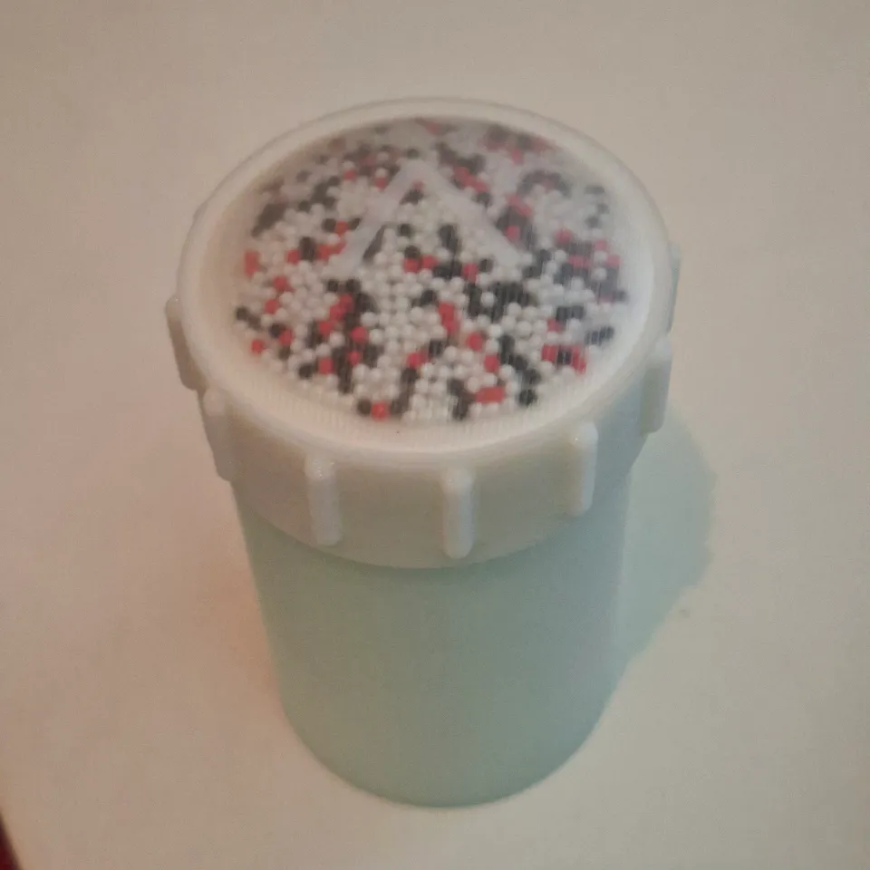
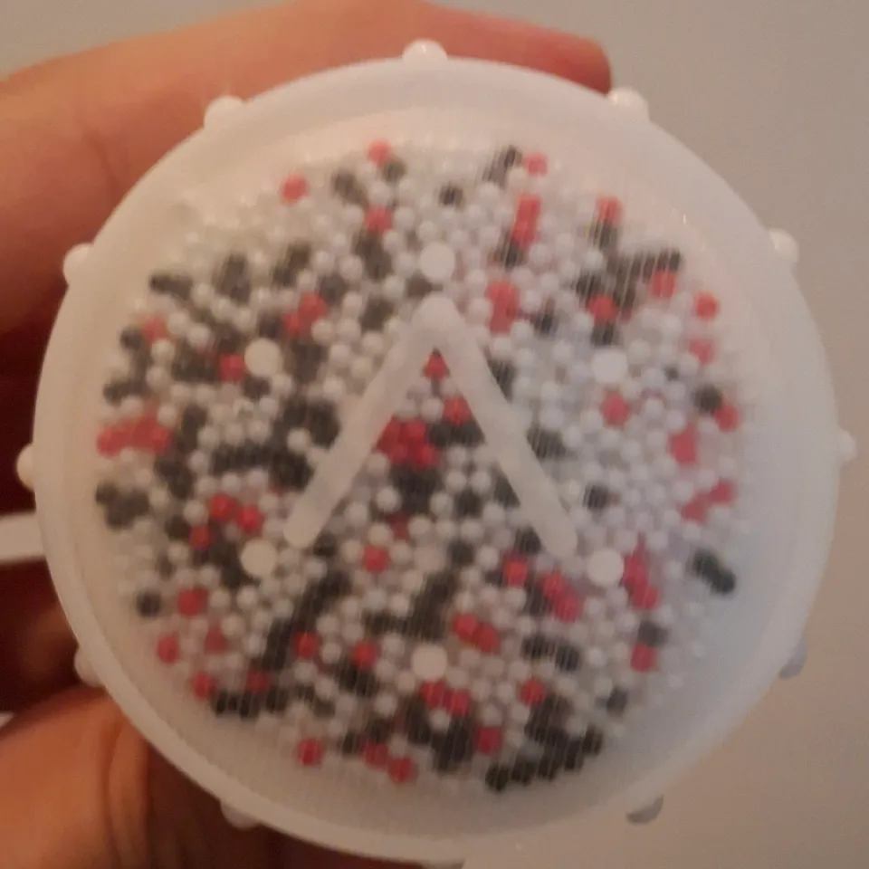
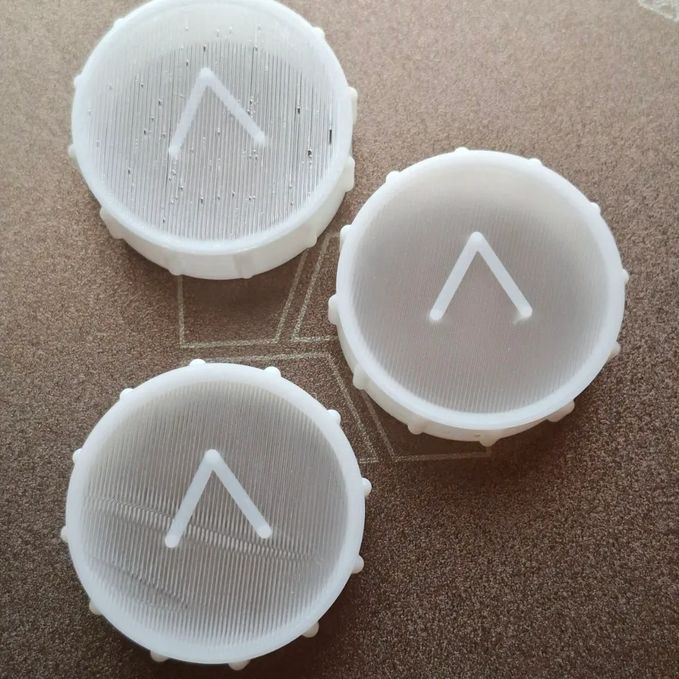
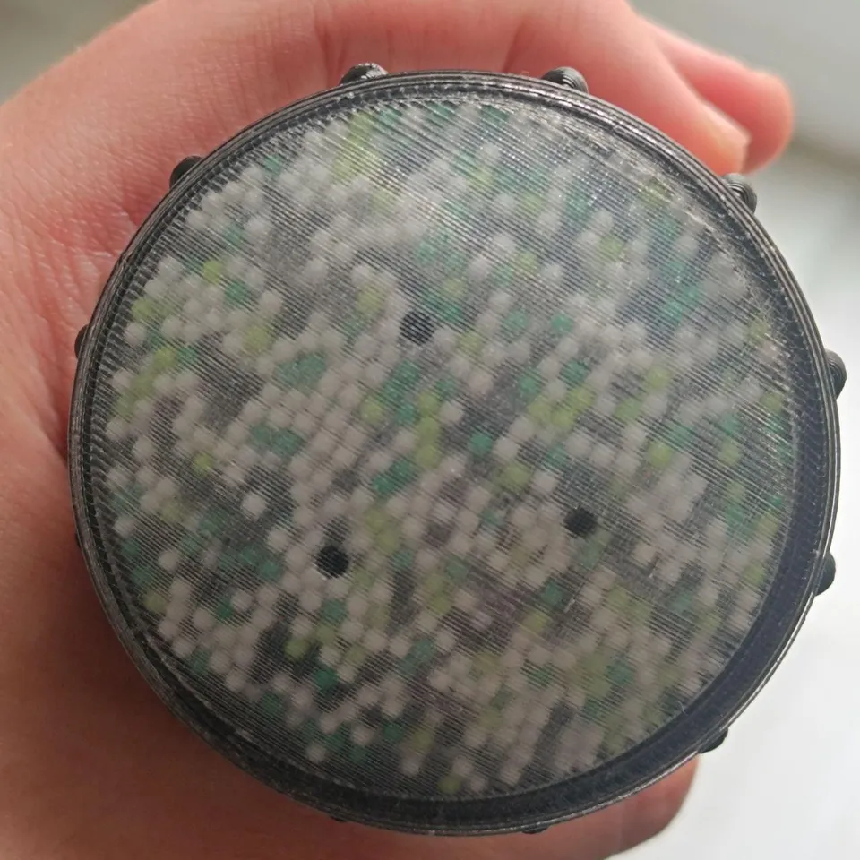
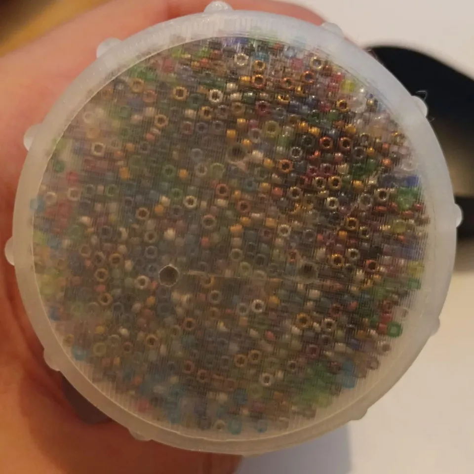

# SeedLocker

A reusable tamper-evident container for SeedSigner and other small items. Closing the lid holds the beads in place; twisting it disturbs the pattern. Photograph the closed lid and compare the pattern before opening it again.

[Printables](https://www.printables.com/model/1207482-seedlocker-a-reusable-tamper-evident-container-for) · [Download all files](https://github.com/xberenguer/SeedLocker/releases/download/printables-2025-11-26/SeedLocker-printables-files.zip)

## Files

The files match the current Printables listing.

| Part | Files |
|---|---|
| Jar | [STL](STL/jar.stl) |
| Middle | [STL](STL/middle.stl) · [3MF with text](3MF/middle-with-text.3mf) |
| Lid | [STL, zipped](STL/lid.stl.zip) · [3MF with V index](3MF/lid-with-v-index.3mf) |
| Editable CAD | [Fusion 360](SeedLocker%20-%20Tamper%20Evident%20Jar.f3d) · [FreeCAD](jar.FCStd) |

The lid STL is zipped to fit GitHub's file-size limit. The geometry is unchanged. [Checksums](SHA256SUMS).

## Printing

- Print the transparent lid window as a single layer of clear 77D TPU on a smooth, flat print bed.
- Print the jar and middle in PLA.
- Use 2 mm beads without holes. The example mix is approximately 12 g, in a ratio of 1 red : 2 black : 6 white.
- Use the V index as a reference when photographing and comparing the lid.

[Blink Comparison](https://github.com/proninyaroslav/blink-comparison) can help compare the pattern photos.

## Photos

 

 

[More photos on Printables](https://www.printables.com/model/1207482-seedlocker-a-reusable-tamper-evident-container-for).

## Videos

- [Seed — lid and index-mark demonstration](https://x.com/sesi_the_man/status/1910075587622031612/video/1)
- [Bead-pattern demonstration](https://github.com/user-attachments/assets/591b7467-79ee-483a-ad4c-2a15a1c9a6f4)

## Credits

Designed by gustavopoa. Commissioned by [🌠🌌.ws](https://xn--sg8hhb.ws/). V index contributed by [Seed](https://x.com/sesi_the_man).

Work in progress. Public domain ([CC0 1.0](https://creativecommons.org/publicdomain/zero/1.0/)), as listed on Printables.
